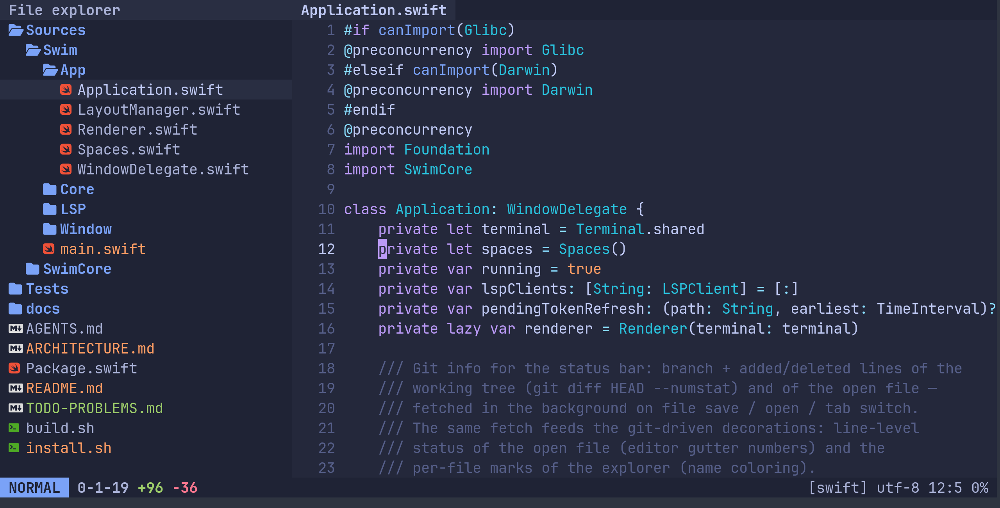

# Это заголовок 1

## Это заголовок 2

### Заголовок 3 с **жирной частью** и [ссылкой](https://example.com)

#### Заголовок 4

##### Заголовок 5

###### Заголовок 6 (уровня 6 в SabyDoc нет — станет жирным абзацем)

Это основной текст с **жирным**, *курсивом*, ***жирным курсивом***, ~~зачёркнутым~~,
`инлайн-кодом` (отображается обычным текстом), комбинированным ~~**жирным зачёркнутым**~~
и <u>подчёркнутым через HTML</u>.

Ссылки: [обычная](https://example.com "Заголовок"), <https://example.org>,
голая https://example.net/page, по ключу [ref] и collapsed [ref][].

Сущности: &amp; &copy; &laquo;кавычки&raquo; &#9731; и эмодзи 🚀 в тексте.

Эскейпы: \*не эмфаз\*, \[не ссылка\], \_не курсив\_.

<div align="center">
Абзац по центру (блочная форма)
</div>

<div align="right">Справа одной строкой</div>

<p align="justify">По ширине через p</p>

Инлайн-комментарий <!-- вот такой --> не виден.

Первая строка  
вторая после жёсткого переноса (два пробела).

Третья строка\
четвёртая после обратного слэша.

- Ненумерованный список
  - Вложенный элемент
    - Ещё глубже с **жирным**
- Второй пункт с `кодом` и [ссылкой](https://example.com)

1. Нумерованный список
2. Второй пункт
   1. Вложенный нумерованный
      - Смешанный маркер

- Пункт со вторым абзацем

  Второй абзац пункта

1. Свободный список
2. Продолжение после пустой строки

- [ ] Задача не выполнена
- [x] Выполненная задача

> Цитата первая строка, ленивое продолжение
>
> Вторая строка цитаты
>
> > Вложенная цитата (схлопнется)

| Колонка 1    | Колонка 2   | Центр | Право | Лево |
|--------------|-------------|:-----:|------:|:-----|
| Обычная      | **Жирная**  |  ce   |    ri | le   |
| *Курсив*     | `код`       |       |       |      |
| a \| экранир. | [ссылка](https://example.com) | x | y | z |

```javascript
// комментарий
let a = 0;
const s = "строка";
```

~~~python
# тройная тильда
x = 1
~~~

    Код с отступом в четыре пробела
    вторая строка



Картинка внутри текста: до  после — разрывает абзац.

Несуществующая картинка: 

Удалённая картинка: 

---

Горизонтальная линия выше — станет разделителем.

Текст после всего.
